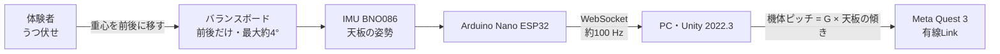

# VRグライダー開発プロジェクト概要

**▶ 作品の詳しい説明ページ：https://gonakano.github.io/vr-glider-project-summary/** （チームで共有する作品紹介。仕組み・論文と受賞）

## 概要

本プロジェクトは、研究室のチーム開発として制作した体感型VR飛行シミュレータです。

身体の傾きを入力として利用する姿勢入力装置とVR空間を組み合わせ、ユーザーが身体を傾けることでVR内のグライダーを操作します。  
IMUセンサーによる姿勢推定、UnityによるVR空間の構築、Meta Quest 3でのVR体験、ESP32との通信による外部デバイス連携などを組み合わせたシステムです。

本リポジトリでは、研究室管理のPrivateプロジェクトであるため、ソースコードは公開せず、担当範囲・使用技術・開発で工夫した点をポートフォリオ用にまとめています。

### 論文・発表

- Tenro Hanamitsu, Hideto Niimi, Go Nakano, Yusei Yoshida, Ryoichi Watanabe, Marie M. Morita, Satoshi Hashiguchi, Fumihisa Shibata, Asako Kimura. **SKY HIGH!!!: A VR Flight Experience Using Tilt Illusion in a Prone Posture.** In *Proceedings of the 32nd ACM Symposium on Virtual Reality Software and Technology (VRST 2026)*, Demo. [https://doi.org/10.1145/3822517.3849972](https://doi.org/10.1145/3822517.3849972)
- 2026年11月16〜18日、東北大学（仙台）でデモ展示。筆頭著者がポスターで研究を説明し、自分は共著者として体験者へのデモ説明と、システム・通信・ハードの仕組みの説明を他の著者と協力して英語で担当しました。
- 新美 秀人, 花光 天朗, 中野 剛, 他. 「SKY HIGH!!!：腹臥位における傾斜錯覚を利用したVR飛行体験」, ヒューマンインタフェースシンポジウム2026（2026年9月、岡山大学）. **優秀プレゼンテーション賞（審査員による選考）受賞**（[受賞者一覧](https://jp.his.gr.jp/symposium/award2026/)）

---

## プロジェクトの特徴

- 身体の傾きを利用してVR空間内のグライダーを操作
- IMUセンサーを用いたリアルタイム姿勢入力
- Meta Quest 3による没入型VR体験
- Unity / C# によるゲーム進行・UI・判定処理の実装
- ESP32との通信を利用した外部デバイス連携
- 通常モードと子供向けモードの切り替え
- GitHub / SourceTreeを用いたチーム開発

---

## 使用技術

- Unity
- C#
- Meta Quest 3
- IMUセンサー
- ESP32
- WebSocket通信
- TCP通信
- Git / GitHub
- SourceTree
- 生成AI（C#コードの生成）

---

## ゲーム内容

本ゲームは、VR空間内でグライダーを操作し、制限時間内にチェックポイントを通過してゴールを目指すタイムアタック型の飛行ゲームです。

プレイヤーは身体の傾きを使って機体を操作し、コース上に配置されたボーナスリングや、見えないチェックポイント壁を通過しながらゴールを目指します。  
ゴール後には走行タイムやボーナスを反映した結果を表示し、ランキングとして記録されます。

また、通常モードに加えて、子供向けに横方向の入力を抑えた簡単な操作モードも用意しました。

---

## システムの技術的な仕組み（チームの成果）

この節は、チーム全体で作ったシステムの仕組みを、VRST 2026の論文に沿って説明したものです。自分の担当は後の「担当範囲」に書いています。

### 背景：なぜ「傾きの誇張」なのか

うつ伏せで乗るVR飛行体験（Birdlyなど）では、機体の姿勢をそのまま台の傾きとして体に返すのが一般的です。しかし急な角度で飛ぶ感覚を出そうとすると、体も同じだけ大きく傾ける必要があり、モーター駆動の台が要ります。安全面の不安が増え、装置も複雑で高価になります。

そこで本システムでは、**体の傾きは小さいまま、VR内の機体の傾きだけを大きく見せる**ことにしました。視覚と同期した体の傾きが、実際より大きな傾きとして感じられる現象（illusory self-tilt）を利用する狙いです。この現象を、うつ伏せで、しかも自分で傾きを作る飛行体験に使った例はほとんどありません。

### 全体構成



### バランスボード：前後だけ傾く入力装置

- 直径1800 mm・厚さ30 mmのバーチ合板の円形天板にうつ伏せで乗り、2本のハンドルを握ります。下に八角形の補強板（1300 mm）を固定し、半球状のバランストレーナー（BOSU Pro NexGen、直径650 mm）を支点にしています。
- 天板に固定した発泡ポリスチレンのブロックで左右の動きを止め、同じブロックで前後の傾きも**最大約4°**に抑えています（安全のため）。当たる面にはウレタンのクッションを置いて衝撃を和らげています。
- うつ伏せを選んだのは、重心の前後移動がそのまま機体のピッチ操作に対応するためです。
- 傾きは天板に付けたIMU（SparkFun VR IMU Breakout、BNO086）でクォータニオンとして取ります。体験者は天板に密着しているので、**天板の傾きを体の傾きの代わり**として使っています（体重や重心位置そのものは測っていません）。ESP32からPCへ、WebSocketで約100 Hzで送ります。

### 傾きの誇張：線形ゲイン

VR内の機体のピッチ角を、天板の傾きに倍率（ゲイン）を掛けて決めます。

```
θv = G · θp   （θp：体（天板）の傾き、θv：機体のピッチ角、G：ゲイン）
```

| ゲイン G | 天板4°のときの機体ピッチ |
|---|---|
| 1 | 4° |
| 5 | 20° |
| 10 | 40° |
| 15 | 60° |
| 20 | 80° |

- コースに等間隔で置いた**4つのチェックポイント**でコースを5区間に分け、1つ通るたびにゲインが 1 → 5 → 10 → 15 → 20 倍と上がります。1回の飛行の中で、「体の傾き＝機体の傾き」から「体よりはるかに大きく傾いて見える」状態へ移っていきます。

### VRアプリ

- Unity 2022.3.52f1で作り、Meta Quest 3をPCに有線（Link）でつないで表示します。機体に乗った一人称視点で、頭の動きはそのまま反映します。
- ボードは前後にしか傾かないので、コースは直線です。体験者は高度を操作してチェックポイントを通ります。
- 機体は傾き θv で動く簡単な滑空モデルで飛びます。機首を下げると速くなるため、ゲインが大きいほど、同じ体の傾きでも速度の変化が大きくなります。
- コースは約3分で、山の上 → S字の川が流れる峡谷 → 高層ビルの街、の3つの場面を飛びます。

### 今後の課題

- 今のゲインは、機体の傾きだけでなく速度の変化にも効いているので、2つの影響をまだ切り分けられていません。
- 速度を揃えたうえで、ゲインが傾きの感じ方・飛行感・VR酔いにどう影響するかを評価する予定です（デモ段階のため、効果はまだ定量的に評価していません）。

---

## 担当範囲

本プロジェクトでは、主にメインゲームシーンの作成・調整と、チーム開発の進行支援を担当しました。

メインゲームシーンのC#コードは生成AIで書かせ、自分は仕様の検討、Unity上での組み込み・調整、実機での動作確認を行いました。

### メインゲームシーン

- `nakano_` 接頭辞のスクリプト群を担当
- メインゲームシーンのゲーム進行管理
- カウントダウン、ゲーム開始、ゴール、リザルト表示
- ボーナスリング、チェックポイント壁、ゴールリングの通過判定処理
- チェックポイント通過時のUI表示
- タイム計測、ボーナスタイム、ランキング保存処理
- ゴール演出やリザルト画面
- サウンド再生の枠組み整備
- 他メンバーが実装した機能との統合作業

### UI / HUD

- Ready表示
- カウントダウン表示
- ゴール表示
- ゲームオーバー表示
- チェックポイント通過時のタイム表示
- リザルト画面
- ランキング表示
- 飛行中HUDとの連携

### 体験設計・操作デバイスの検討

チームで話し合いながら、次の点を検討しました。

- 身体の傾きを使った姿勢入力の体験
- 操作デバイスの形（円板や半円のバランスボールを使う案など）
- 小さな傾きでも、VR内では大きく動いているように感じられる操作感

### 実機での試験・不具合対応

- Meta Quest 3、IMUセンサー、ESP32をつないだ実機での動作確認
- Unity側・センサー・Wi-Fi・マイコン側のどこに原因があるかの切り分け

### チーム開発・Git運用

- GitHub / SourceTreeの使い方を学習し、チームメンバーへ共有
- SourceTreeを用いたブランチ管理
- メンバーごとに分けた作業内容の統合
- シーンやスクリプトのマージ作業
- コンフリクト発生時の対応
- 作業分担や未実装タスクの整理
- 不具合や改善点の洗い出し
- チーム全体の開発方針や修正点の整理

---

## 担当した主な機能

以下の機能は、C#のコードを生成AIで書かせ、自分は仕様の検討、Unity上での組み込み・調整、動作確認を行いました。

### ゲーム進行管理

ゲーム開始前の待機状態、カウントダウン、飛行中、ゴール後、リザルト表示までの一連の流れを管理しました。

待機中・プレイ中・リザルト表示中といった状態を分けることで、ゲーム中のみ判定やタイム計測が動作し、リザルト画面では入力や演出が適切に切り替わるようにしました。

---

### ボーナスリング・チェックポイント・ゴール処理

コース上に配置されたボーナスリング、見えないチェックポイント壁、ゴールリングを通過した際の判定処理を組み込みました。

それぞれのオブジェクトの役割に応じて処理を分け、以下のような機能を組み込みました。

- ボーナスリング通過時のタイムボーナス加算
- チェックポイント壁通過時のタイム表示
- ゴールリング通過時のゲーム終了処理
- 二重判定を防ぐための通過済みフラグ
- 通過後のオブジェクト削除処理

---

### リザルト・ランキング機能

ゴール後に、走行タイム、ボーナスタイム、最終タイム、ミス回数、通過リング数などを表示するリザルト画面を組み込みました。

また、過去の記録を保存し、ランキングとして表示できるようにしました。  
通常モードと子供向けモードではシーンを分けているため、それぞれ別の記録として扱える構成にしています。

---

### サウンド管理

カウントダウン、スタート、リング通過、チェックポイント、ゴール、衝突、リザルトBGMなどを管理できる枠組みを組み込みました。

音源をUnityのInspectorから設定できるようにし、後から音の差し替えや調整をしやすい構成にしました。

---

### 通常モード・子供向けモードの分岐

体験者に応じて通常モードと子供向けモードを切り替えられるようにしました。

子供向けモードでは横方向の入力を抑えることで、操作難易度を下げ、初めて体験する人でも遊びやすいようにしています。

---

### チームメンバー機能との統合

チュートリアル、飛行制御、HUD、逆走検知など、他メンバーが担当した機能とメインゲームシーンを統合しました。

Unityではシーンファイルのマージが難しいため、作業範囲を分けながら、最終的に手動で統合する運用を行いました。

---

## 工夫した点

### 1. チーム開発しやすい構成を意識したこと

複数人でUnityプロジェクトを開発する場合、同じシーンを同時に編集するとコンフリクトが起きやすくなります。

そのため、作業するシーンや担当範囲を分け、スクリプト単位で統合しやすくすることを意識しました。

---

### 2. ゲーム状態を分けて管理したこと

待機中、プレイ中、リザルト表示中など、ゲームの状態を分けて管理することで、不要な判定や入力が発生しないようにしました。

これにより、リング判定、チェックポイント判定、タイム計測、サウンド再生、リザルト表示などを整理しやすくしました。

---

### 3. デモ時に復旧しやすい操作を用意したこと

発表や体験会での利用を想定し、キーボード操作によるシーン切り替えやリロードを用意しました。

通常モードと子供向けモードを切り替えられるようにし、体験者に応じた運用ができるようにしました。

---

### 4. Inspectorから調整しやすい構成にしたこと

音源、UI、リング設定、チェックポイント設定などをUnityのInspectorから調整できるようにし、コードを書き換えなくても体験の調整ができるようにしました。

これにより、チームメンバーがUnity上で設定を変更しやすくなり、デモ前の調整もしやすくなりました。

---


## 苦労した点

### Unityシーンの統合

Unityのシーンファイルは差分管理やマージが難しく、複数人で同じシーンを編集するとコンフリクトが発生しやすいという問題がありました。

そのため、作業範囲を分けたり、SourceTreeを使ってブランチの状態を確認したりしながら、慎重に統合作業を進めました。

---

### VR実機とEditor上での挙動差

Unity Editor上では問題なく動作しても、Meta Quest 3で実行するとカメラ位置や操作感、パフォーマンスに違いが出ることがありました。

そのため、Editor上での確認だけでなく、研究室のPCと実機を使った確認が必要でした。

---

### ハードウェア連携

IMUセンサーやESP32など、Unity外部のハードウェアと連携するため、通信状態や接続先の確認が重要でした。

Unity側のコードだけでなく、センサー、Wi-Fi、マイコン側の状態も考慮しながらデバッグを行う必要がありました。

---

### Git / SourceTreeのチーム運用

チームメンバー全員がGitやSourceTreeに慣れているわけではなかったため、自分自身も学びながら、基本的な使い方やブランチ運用を共有しました。

特にUnityプロジェクトでは大容量ファイルやシーンファイルの扱いが難しく、通常のプログラム開発とは違う注意が必要でした。

---

## 学んだこと

- Unityでのゲーム進行・UIの組み立てと調整
- VR体験におけるUI・操作感・演出の重要性
- IMUセンサーやESP32などの外部デバイスと連携したシステムの試験と、不具合の切り分け
- GitHub / SourceTreeを使ったチーム開発の進め方
- Unityプロジェクトにおけるシーン分割・ブランチ管理・統合作業の難しさ
- チーム内でタスクや課題を整理し、修正方針を共有する重要性
- デモや発表を想定した安定性・復旧手段の重要性
- 生成AIが書いたコードを組み込むときも、仕様の決定と実機での確認は自分で行う必要があること
- チーム全体が開発しやすい状態を作ることの重要性

---

## このプロジェクトで意識したこと

本プロジェクトでは、単にゲームを作るだけでなく、実際に人が体験するVRシステムとして成立することを意識しました。

特に、以下の点を重視しました。

- 体験者が直感的に操作できること
- デモ中にトラブルが起きても復旧しやすいこと
- チームメンバーの実装を統合しやすいこと
- 通常モードと子供向けモードを切り替えられること
- 研究室プロジェクトとして、発表や体験に使える状態に近づけること

---

## ソースコードについて

本プロジェクトは研究室・チーム開発のPrivateリポジトリで管理されているため、ソースコードや詳細な内部資料は公開していません。

このリポジトリでは、就職活動やポートフォリオで説明できる範囲に限定し、プロジェクト概要・担当範囲・使用技術・学んだことをまとめています。
